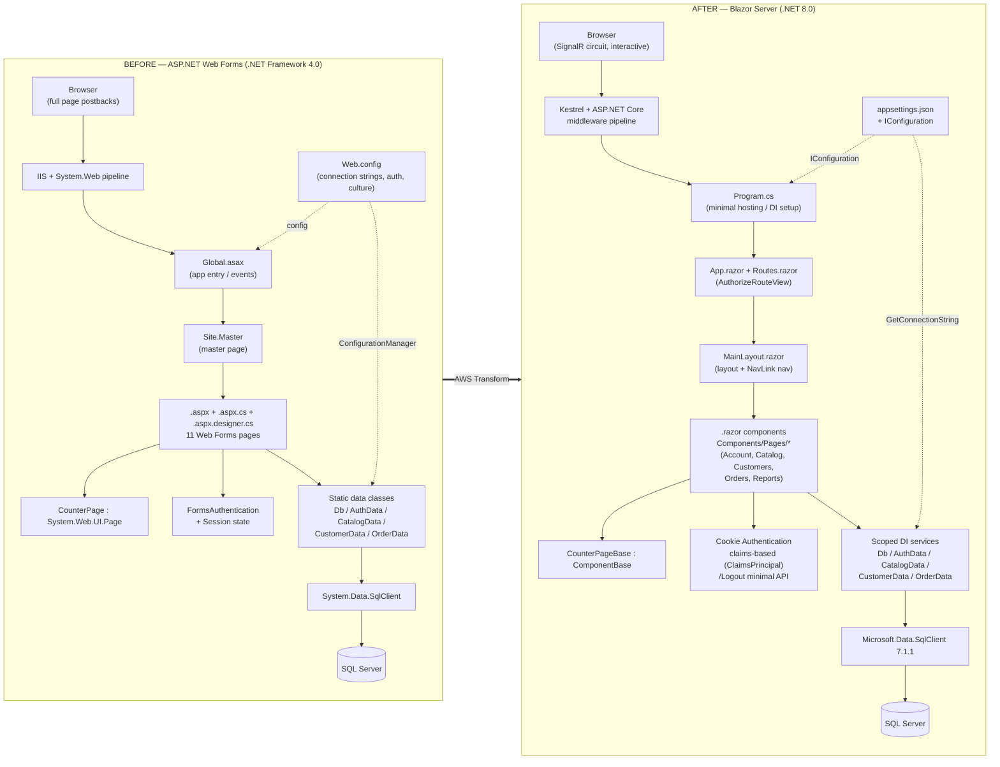
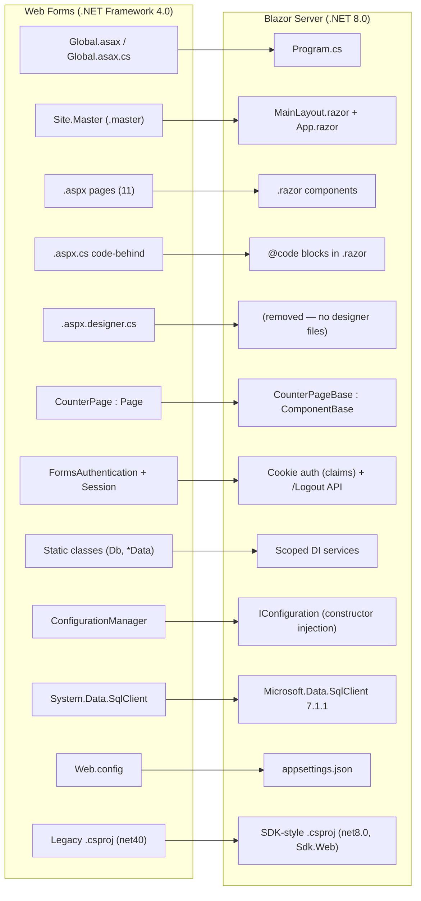
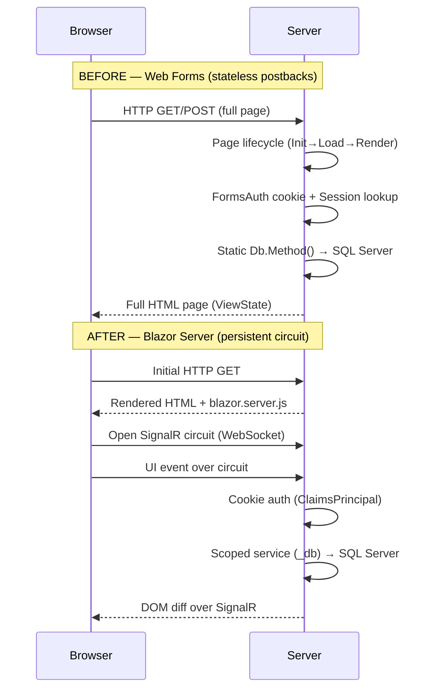

# ApexCounter — Architecture: Before vs After Transformation

Migration from **ASP.NET Web Forms (.NET Framework 4.0)** to **Blazor Server (.NET 8.0)**.

---

## High-Level Before / After

---

## Component-by-Component Mapping

---

## Request Lifecycle: Before vs After

---

## Summary of Key Shifts

| Concern | Before | After |
|---|---|---|
| UI framework | ASP.NET Web Forms (.aspx) | Blazor Server (.razor) |
| Rendering | Full-page postbacks + ViewState | SignalR circuit, DOM diffing |
| Entry point | Global.asax | Program.cs (minimal hosting) |
| Layout | Site.Master | MainLayout.razor / App.razor |
| Base page | CounterPage : System.Web.UI.Page | CounterPageBase : ComponentBase |
| Auth | FormsAuthentication + Session | Cookie auth, claims-based + /Logout API |
| Data access | Static classes | Scoped DI services |
| Config | Web.config + ConfigurationManager | appsettings.json + IConfiguration |
| SQL client | System.Data.SqlClient | Microsoft.Data.SqlClient 7.1.1 |
| Target framework | .NET Framework 4.0 | net8.0 |
| Project format | Legacy .csproj | SDK-style (Microsoft.NET.Sdk.Web) |
| Host | IIS + System.Web | Kestrel + ASP.NET Core |

**File stats:** 65 files changed — 14 added, 46 deleted, 5 modified. +1 NuGet (Microsoft.Data.SqlClient 7.1.1), -1 NuGet (Microsoft.NETFramework.ReferenceAssemblies.net40).
